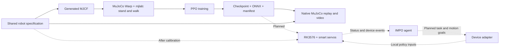

# Corgi RL

**A quadruped with a local motion policy and planned IMPO integration.**

Corgi RL is an open-source, low-cost **12-DoF quadruped** project. It brings a
calibratable robot model, stand and walk tasks, and a shared policy interface
into one repository. The planned hardware uses smart servos and a Rockchip
RK3576 board.

*The image above is a Gemini-generated concept render of the proposed appearance.
It is not a photograph, a validated mechanical design, or the current simulator model.*

**Status: the bounded GPU smoke pipeline passed on October 27, 2026.**
Stand and walk each completed two PPO iterations, ONNX export, and a three-second
replay. This does not establish a learned gait, convergence, or hardware readiness.
Initial dimensions, masses, and actuator parameters remain estimates.

## Local motion policy + IMPO

Corgi is designed to be an **IMPO gadget with its own motion controller**.
The local policy handles joint control, standing and locomotion. IMPO provides
the agent interface: user intent, tasks, gadget commands and device events.
The planned RK3576 runtime connects these layers through a device adapter.

IMPO sends bounded motion goals; the local controller converts them into policy
inputs and joint targets at 50 Hz. Device status returns to IMPO. Local control,
command expiry and safe stopping must remain independent of network availability.

The simulation, PPO and ONNX path is smoke-tested. **RK3576 deployment and IMPO
integration are planned, not implemented.** See the
[integration design](docs/impo-integration.md) and the existing
[IMPO Gadget SDK](https://github.com/impoai/impo-gadget-sdk).

## Architecture



Each leg has three actuated joints: hip abduction, hip pitch, and knee pitch.
The current simulation model uses original boxes, capsules, and spheres.
The proposed shell and corgi-like appearance are a separate design step.

| Path | Purpose |
|---|---|
| `src/corgi_rl/specs/corgi.json` | Canonical robot parameters in SI units |
| `src/corgi_rl/spec.py` | Validation, specification hash, action and hardware coordinate conversion |
| `src/corgi_rl/model.py`, `models/` | MJCF generator and generated model |
| `src/corgi_rl/tasks.py` | Standing and velocity-tracking tasks |
| `src/corgi_rl/train.py` | PPO, checkpoints, ONNX export, and export error checks |
| `src/corgi_rl/native.py` | Native MuJoCo replay, metrics, and H.264 video |
| `tests/` | Specification, model, fixed-PD standing, GPU resets and physics contracts |
| `hardware/` | Calibration plan and supplier data requirements |
| `deploy/` | RK3576 interface, remote smoke test, and Slurm template |
| `docs/design.md` | Technical choices and implementation boundaries |
| `docs/status.md` | Completed checks, known issues, and pending work |
| `docs/concept-render.md` | Concept image provenance and generation prompt |
| `uv.lock` | Complete dependency lock |

## Verified so far

The run used one NVIDIA H200, MuJoCo Warp for simulation, and PPO on CUDA.
All six tests passed in 16.30 seconds. They check native model/calibration,
fixed-PD standing, seeded replay, and GPU stepping, reset, fall termination,
initial observations, physics settings, actuator gains/limits and ground friction.

| Check | Stand | Walk |
|---|---:|---:|
| PPO iterations | 2 | 2 |
| Simulated transitions | 1,536 | 1,536 |
| Maximum policy parameter change | 0.004280 | 0.004404 |
| ONNX/PyTorch maximum absolute error | 1.01e-7 | 8.94e-8 |
| Replay duration | 3 seconds | 3 seconds |
| Fall during this replay | None | None |
| Mean XY velocity error | 0.00862 m/s | 0.20554 m/s |

The walk replay commands 0.2 m/s forward speed. Its error remains about the
command magnitude: **the smoke policy has not learned useful walking**.
Each task has a saved checkpoint, ONNX graph, calibration manifest and H.264 video.
The native CPU simulator and OSMesa renderer ran on the remote compute node.
EGL was unavailable on that node; CUDA training was verified separately.

[Stand replay](docs/assets/smoke-stand.mp4) ·
[Walk replay](docs/assets/smoke-walk.mp4) ·
[Detailed validation](docs/status.md)

## Stack

The project uses released **mjlab 1.6.0**, **MuJoCo/MuJoCo Warp 3.11.0**, and
**rsl_rl 5.4.2 PPO**, with PyTorch 2.9.1 and Warp 1.14.0. These are upstream
package dependencies. The project does not maintain a training-framework fork.

Native MuJoCo provides remote CPU replay and cross-checks. Parallel training
uses Linux and NVIDIA GPUs. `uv.lock` pins direct and transitive dependencies.
MJX is a possible future backend; the current implementation has one training path.

## Run on the remote machine

Python environments, package installation, simulation, training, and tests run
on the remote NVIDIA environment. The development Mac is for source editing.
Do not execute the following installation or runtime commands on that Mac.

Use Linux x86_64, Python 3.11, and an NVIDIA GPU. Prepare the rendering libraries
and environment variables using [the remote runtime guide](docs/remote-runtime.md)
before running these bounded commands. The verified rendering backend is OSMesa.
Private cluster addresses, credentials, and access instructions are kept outside
this repository.

```bash
# Prepare dependencies on the remote login node before allocating a GPU.
uv sync --locked --python 3.11
uv run --locked corgi model
uv run --locked pytest tests/test_spec_and_native.py -q

# On an allocated NVIDIA GPU, check the environment before a bounded PPO run.
uv run --locked pytest tests/test_gpu.py -q
uv run --locked corgi train --task stand --output runs/stand-smoke \
  --num-envs 32 --steps 24 --iterations 2
uv run --locked corgi train --task walk --output runs/walk-smoke \
  --num-envs 32 --steps 24 --iterations 2

# Replay the exported policy and save metrics with an H.264 video.
uv run --locked corgi evaluate --task walk \
  --policy runs/walk-smoke/policy.onnx --seconds 5 --video runs/walk-smoke.mp4
```

Use a new output directory for each training run. To resume, pass
`--resume runs/stand-smoke/checkpoint.pt --output runs/stand-resume`.
The iteration count specifies additional iterations. Resume remains untested;
exact reproduction of random-number and environment state is not guaranteed.

If the container has no Git executable, set `GIT_PYTHON_REFRESH=quiet` before
importing the training stack. The Slurm smoke script sets it. Record the source
revision on the submission host. Other images need dependency and driver checks.

`deploy/slurm-smoke.sbatch` expects prepared source and environment archives.
The repository has no automation that submits jobs or starts training.

## Shared calibration contract

- Joint order: `FL, FR, RL, RR`, with `hip, thigh, knee` for each leg.
- Physics step: 4 ms. Policy action every five steps: **50 Hz**.
- Actor observation: 45 values — body angular velocity (3), gravity direction
  (3), velocity command (3), joint position relative to home (12), scaled joint
  velocity (12), and previous clipped action (12).
- Action: 12 values, clipped to `[-1,1]`, mapped to `home + scale × action`,
  then limited to each joint's angle range. Actuators use torque-limited PD control.
- The ONNX manifest records the specification SHA-256, joint order, units,
  and control rate. Replay checks the specification hash.
- Each joint supports calibration of direction, zero, limits, gains, torque,
  armature, and friction. Each body can receive measured mass, center of mass,
  and diagonal inertia.

Voltage sag, torque-speed curves, latency, backlash, thermal effects, and sensor
noise are not modeled yet. The initial walk task tracks commanded velocity.
Gait quality, rewards, and randomization need evaluation through actual training.
See the [calibration plan](hardware/README.md) and [deployment interface](deploy/README.md).

## Next steps

1. Review the smoke videos, shared specification and robot geometry.
2. Validate checkpoint recovery and dynamic cross-backend trajectories.
3. Improve gait rewards and evaluate broader seeds before authorizing longer training.
4. Obtain and calibrate real actuator and mechanical parameters before hardware work.

## License

Project source and original primitive geometry use [Apache-2.0](LICENSE).
Runtime dependencies retain their respective licenses. See [NOTICE](NOTICE).
