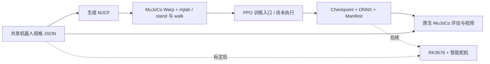

# Corgi RL · 柯基

一个从仿真开始的低成本 **12-DoF 四足机器人**项目。先建立可校准的模型、
站立与行走任务和策略接口，再对接供应链智能舵机及 Rockchip RK3576。

**当前阶段：初版仓库，等待设计审阅。未启动 PPO 训练，未验证学会行走，
不具备实机运行条件。** 初始尺寸、质量、舵机参数都是估计值。

Python 环境、依赖安装、仿真、训练和测试只在远端 NVIDIA 环境运行。
本机 Mac 仅编辑源码。不要在 Mac 上执行下面的安装或运行命令。

## 架构



每条腿有髋外展、髋俯仰、膝俯仰 3 个关节。模型由原创箱体、胶囊体和球体
构造。项目名是 Corgi；初版没有模拟真实柯基的骨骼比例或动物运动约束。

| 目录/文件 | 用途 |
|---|---|
| `src/corgi_rl/specs/corgi.json` | 唯一机器人参数源；使用 SI 单位 |
| `src/corgi_rl/spec.py` | 参数校验、规格哈希、动作与硬件坐标转换 |
| `src/corgi_rl/model.py`、`models/` | MJCF 生成器及生成结果 |
| `src/corgi_rl/tasks.py` | mjlab 站立与速度跟踪任务 |
| `src/corgi_rl/train.py` | PPO、checkpoint、ONNX 导出与误差检查入口 |
| `src/corgi_rl/native.py` | 原生 MuJoCo 回放、指标和 H.264 视频 |
| `tests/` | 参数、模型、固定 PD 站立，以及待运行的 GPU 测试 |
| `hardware/` | 标定方案与供应商信息清单 |
| `deploy/` | RK3576 接口边界、远端 smoke test 和 Slurm 模板 |
| `docs/references.md` | Jumper、Microduck 实现与许可证核对 |
| `docs/status.md` | 实际验证范围、已知问题与待办 |
| `uv.lock` | 远端解析的完整依赖锁 |

## 已完成的验证

2026-10-27，在远端集群的 PyTorch 容器中执行：

- **4 项基础测试通过**：模型/共享参数接口、非法输入拒绝、固定 PD 站立
  3 秒、同一随机种子的回放一致性。
- 模型编译为 `nq=19`、`nv=18`、`nu=12`：浮动基座加 12 个驱动关节。
- 站立测试检查未跌倒、机身高度及 2.5 N·m 的执行器力矩上限。
- 依赖锁定及安装完成，MJCF 已生成。

**尚未执行**：GPU 环境步进/重置测试、PPO 更新、checkpoint 恢复、ONNX
数值一致性检查、视频渲染、硬件测试。源码中有这些入口不代表已验证。
遵照用户要求，在审阅仓库前不提交 GPU 训练作业。

## 技术选择

使用发布版 **mjlab 1.6.0 + MuJoCo/MuJoCo Warp 3.11.0 + rsl_rl 5.4.2 PPO**，
搭配 PyTorch 2.9.1、Warp 1.14.0。使用上游依赖，不维护 Jumper 的框架分叉。
MJX 是未来可选后端；当前不同时实现两套训练后端。

原生 MuJoCo 用于远端 CPU 回放及交叉检查。正式并行训练使用 Linux/NVIDIA。
`uv.lock` 同时锁住间接依赖；不从不断变化的上游 `main` 安装。

## 远端运行命令

以下命令供审阅后在远端执行，**本次没有运行训练命令**。
推荐 Linux x86_64、Python 3.11、NVIDIA GPU 和可用的 EGL。
私有集群地址、密钥路径和访问说明不随仓库公开。

```bash
# 在远端登录节点准备依赖；不要占着 GPU 安装包。
uv sync --locked --python 3.11
uv run --locked corgi model
uv run --locked pytest tests/test_spec_and_native.py -q

# 在分配好的 NVIDIA GPU 上先验证环境，再做有界的训练 smoke test。
uv run --locked pytest tests/test_gpu.py -q
uv run --locked corgi train --task stand --output runs/stand-smoke \
  --num-envs 32 --steps 24 --iterations 2
uv run --locked corgi train --task walk --output runs/walk-smoke \
  --num-envs 32 --steps 24 --iterations 2

# 回放导出的策略，保存实际指标及 H.264 视频。
MUJOCO_GL=egl uv run --locked corgi evaluate --task walk \
  --policy runs/walk-smoke/policy.onnx --seconds 5 --video runs/walk-smoke.mp4
```

训练输出目录必须是新目录，避免覆盖旧 run。恢复训练使用
`--resume runs/stand-smoke/checkpoint.pt --output runs/stand-resume`；迭代数表示
本次新增的迭代数。恢复入口尚未执行验证，不保证精确重现 RNG/环境状态。

容器没有 Git 时，先设置 `GIT_PYTHON_REFRESH=quiet`；Slurm smoke 脚本已设置。
Git 来源信息应由提交作业的主机记录。其他镜像需要先核对依赖和驱动。
`deploy/slurm-smoke.sbatch` 要求先准备源码和环境归档；仓库没有自动提交
作业或启动训练的配置。

## 可校准的共享接口

- 关节顺序为 `FL, FR, RL, RR`，每腿 `hip, thigh, knee`。
- 物理步长 4 ms；每 5 步一次策略动作，即 **50 Hz**。
- Actor 观察是 45 维：机身角速度 3、重力方向 3、速度命令 3、相对关节角
  12、缩放关节角速度 12、上一次限幅后的动作 12。
- 输出 12 维动作，先限幅到 `[-1,1]`，再映射为 `home + scale × action`，
  最后应用关节角度限位。执行器采用有力矩上限的 PD 模型。
- ONNX manifest 记录规格 SHA-256、顺序、单位和频率。回放入口检查规格哈希。
- 每个关节可校准方向、零位、限位、增益、力矩上限、惯量与摩擦。
  每个刚体可补充质量、质心及对角惯量。

当前没有模拟电压下降、力矩-转速曲线、延迟、齿隙、热衰减和传感器噪声。
初版 walk 是速度跟踪任务；步态质量、奖励设计和随机化需实际训练后评估。
详见 [硬件标定](hardware/README.md) 和 [部署接口](deploy/README.md)。

## 下一步

1. 审阅机器人规格、接口和目录设计。
2. 在单卡 H200 上执行 GPU 环境测试，修复暴露的问题。
3. 执行短程 PPO、保存/恢复、ONNX 和渲染 smoke test，记录证据。
4. 取得真实舵机与机械参数，标定后再扩大训练。

## 开源与来源

本项目源码和原创基础几何采用 [Apache-2.0](LICENSE)。
没有复制 Jumper/Microduck 的模型、网格、策略权重或专用硬件驱动。
Microduck 指定 STL 网格采用 CC BY-NC-SA-4.0，不能当作 Apache-2.0 资产处理。
参考项目及许可证见 [来源核对](docs/references.md) 和 [NOTICE](NOTICE)。
