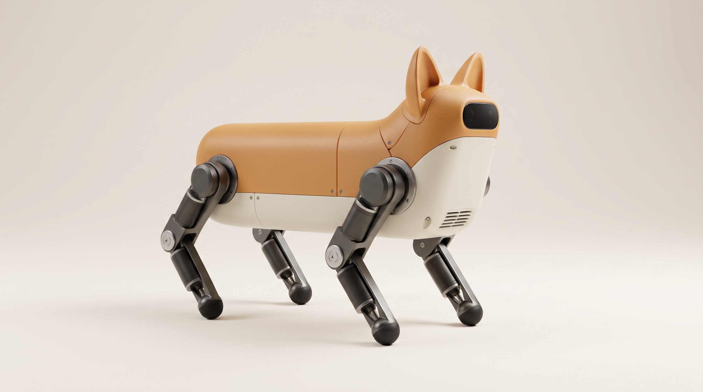
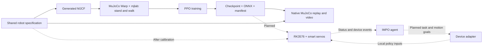
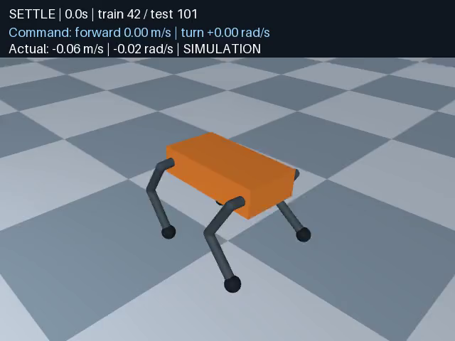

# Corgi RL

**A quadruped with a local motion policy and planned IMPO integration.**

**[Watch all three policies side by side →](https://corgi-rl-walking.meowooof.chatgpt.site)**

Public video demo — no sign-in required. Play forward motion, left/right turns
and stopping together in your browser.

Corgi RL is an open-source, low-cost **12-DoF quadruped** project. It brings a
calibratable robot model, stand and walk tasks, and a shared policy interface
into one repository. The planned hardware uses smart servos and a Rockchip
RK3576 board.

*The image above is a Gemini-generated concept render of the proposed appearance.
It is not a photograph, a validated mechanical design, or the current simulator model.*

**Status: a learned flat-ground policy passes forward, left/right turn and stop tests.**
The released policy passed ten held-out reset seeds, each with a continuous
30-second command sequence and no falls. Training and validation ran on remote
NVIDIA infrastructure. Initial physical parameters remain estimates; this is
simulation evidence, not hardware readiness or a general convergence claim.

## Local motion policy + IMPO

Corgi is designed to be an **IMPO gadget with its own motion controller**.
The local policy handles joint control, standing and locomotion. IMPO provides
the agent interface: user intent, tasks, gadget commands and device events.
The planned RK3576 runtime connects these layers through a device adapter.

IMPO sends bounded motion goals; the local controller converts them into policy
inputs and joint targets at 50 Hz. Device status returns to IMPO. Local control,
command expiry and safe stopping must remain independent of network availability.

The simulation, PPO and ONNX path has passed locomotion tests. **RK3576 deployment and IMPO
integration are planned, not implemented.** See the
[integration design](docs/impo-integration.md) and the existing
[IMPO Gadget SDK](https://github.com/impoai/impo-gadget-sdk).

## Architecture



Each leg has three actuated joints: hip abduction, hip pitch, and knee pitch.
The current simulation model uses original boxes, capsules, and spheres.
The proposed shell and corgi-like appearance are a separate design step.

| Path | Purpose |
|---|---|
| `src/corgi_rl/specs/corgi.json` | Canonical robot parameters in SI units |
| `src/corgi_rl/spec.py` | Validation, specification hash, action and hardware coordinate conversion |
| `src/corgi_rl/model.py`, `models/` | MJCF generator and generated model |
| `src/corgi_rl/tasks.py` | Standing and velocity-tracking tasks |
| `src/corgi_rl/train.py` | PPO, checkpoints, ONNX export, and export error checks |
| `src/corgi_rl/native.py`, `benchmark.py` | Native MuJoCo replay, fixed locomotion gate and H.264 video |
| `src/corgi_rl/export.py`, `policies/` | Checkpoint export and a tested portable policy |
| `tests/` | Specification, model, fixed-PD standing, GPU resets and physics contracts |
| `hardware/` | Calibration plan and supplier data requirements |
| `deploy/` | RK3576 interface, remote smoke test, and Slurm template |
| `docs/design.md` | Technical choices and implementation boundaries |
| `docs/status.md` | Completed checks, known issues, and pending work |
| `docs/concept-render.md` | Concept image provenance and generation prompt |
| `uv.lock` | Complete dependency lock |

## Flat-ground walking

The released seed-42 policy used 1,200 PPO updates with 1,024 environments and
24 rollout steps: 29,491,200 transitions. It passed development seeds 7, 11 and
23 before final testing on seeds 101 through 110. The fixed 30-second sequence
is settle, forward, left turn, forward, right turn, stop. No command-triggered
controller switching or scripted joint trajectory is used: the ONNX actor
produces every action throughout the episode.

| Released policy: ten final episodes | Measured result |
|---|---:|
| Full protocol passed | 10 / 10 |
| Falls across 300 seconds | 0 |
| Mean straight speed, target 0.20 m/s | 0.187–0.207 m/s |
| Worst segment mean XY velocity error | 0.0403 m/s |
| Worst segment mean yaw-rate error | 0.0836 rad/s |
| Worst stopped RMS speed | 0.0279 m/s |
| Stopped displacement over final four seconds | 3.5–5.7 cm |

Stopping meets the stated threshold but is not perfectly motionless. The robot
still has small residual movement. These tests cover estimated physics and flat
ground, without pushes, obstacles or hardware randomization.

Independent training seeds 43 and 44 also passed all ten final reset seeds:
**30/30 final episodes, 900 seconds, no falls across three policies**. Seed 43
used 1,200 updates. Seed 44 failed the development stop-rotation gate at 1,200
updates and needed 600 additional updates before final testing. The rewards,
PPO settings and acceptance thresholds were unchanged. See the
[full results and failed qualification](docs/status.md).

[Watch the public side-by-side demo](https://corgi-rl-walking.meowooof.chatgpt.site) ·
[Download the 30-second replay](docs/assets/walking-train42.mp4) ·
[Download the policy and checkpoint](policies/flat-ground-v1/) ·
[Test protocol](docs/walking-validation.md) · [Detailed validation](docs/status.md)



Training uses MuJoCo Warp and PPO on CUDA. Evaluation runs the exported ONNX
actor in native MuJoCo; video uses OSMesa CPU rendering on the remote compute
node. The earlier two-update smoke results remain in the validation history.

## Stack

The project uses released **mjlab 1.6.0**, **MuJoCo/MuJoCo Warp 3.11.0**, and
**rsl_rl 5.4.2 PPO**, with PyTorch 2.9.1 and Warp 1.14.0. These are upstream
package dependencies. The project does not maintain a training-framework fork.

Native MuJoCo provides remote CPU replay and cross-checks. Parallel training
uses Linux and NVIDIA GPUs. `uv.lock` pins direct and transitive dependencies.
MJX is a possible future backend; the current implementation has one training path.

## Run on the remote machine

Python environments, package installation, simulation, training, and tests run
on the remote NVIDIA environment. The development Mac is for source editing.
Do not execute the following installation or runtime commands on that Mac.

Use Linux x86_64, Python 3.11, and an NVIDIA GPU. Prepare the rendering libraries
and environment variables using [the remote runtime guide](docs/remote-runtime.md)
before running these bounded commands. The verified rendering backend is OSMesa.
Private cluster addresses, credentials, and access instructions are kept outside
this repository.

```bash
# Prepare dependencies on the remote login node before allocating a GPU.
uv sync --locked --python 3.11
uv run --locked corgi model
uv run --locked pytest tests/test_spec_and_native.py -q

# On an allocated NVIDIA GPU, check the environment before a bounded PPO run.
uv run --locked pytest tests/test_gpu.py -q
uv run --locked corgi train --task stand --output runs/stand-smoke \
  --num-envs 32 --steps 24 --iterations 2
uv run --locked corgi train --task walk --output runs/walk-smoke \
  --num-envs 32 --steps 24 --iterations 2

# Replay the exported policy and save metrics with an H.264 video.
uv run --locked corgi evaluate --task walk \
  --policy runs/walk-smoke/policy.onnx --seconds 5 --video runs/walk-smoke.mp4

# Replay the trained policy through the complete command-sequence test.
uv run --locked corgi benchmark --policy policies/flat-ground-v1/policy.onnx \
  --output runs/flat-ground-test --seeds 101 102 103 104 105 106 107 108 109 110 \
  --video-seed 101
```

Use a new output directory for each training run. To resume, pass
`--resume runs/stand-smoke/checkpoint.pt --output runs/stand-resume`.
The iteration count specifies additional iterations. Checkpoint and optimizer
continuation was tested on training seed 44; exact reproduction of random-number
and physical environment state is not supported.

If the container has no Git executable, set `GIT_PYTHON_REFRESH=quiet` before
importing the training stack. The Slurm smoke script sets it. Record the source
revision on the submission host. Other images need dependency and driver checks.

`deploy/slurm-smoke.sbatch` expects prepared source and environment archives.
The repository has no automation that submits jobs or starts training.

## Shared calibration contract

- Joint order: `FL, FR, RL, RR`, with `hip, thigh, knee` for each leg.
- Physics step: 4 ms. Policy action every five steps: **50 Hz**.
- Actor observation: 45 values — body angular velocity (3), gravity direction
  (3), velocity command (3), joint position relative to home (12), scaled joint
  velocity (12), and previous clipped action (12).
- Action: 12 values, clipped to `[-1,1]`, mapped to `home + scale × action`,
  then limited to each joint's angle range. Actuators use torque-limited PD control.
- The ONNX manifest records the specification SHA-256, joint order, units,
  and control rate. Replay checks the specification hash.
- Each joint supports calibration of direction, zero, limits, gains, torque,
  armature, and friction. Each body can receive measured mass, center of mass,
  and diagonal inertia.

Voltage sag, torque-speed curves, latency, backlash, thermal effects, and sensor
noise are not modeled yet. The initial walk task tracks commanded velocity.
Gait quality, rewards, and randomization need evaluation through actual training.
See the [calibration plan](hardware/README.md) and [deployment interface](deploy/README.md).

## Next steps

1. Review the smoke videos, shared specification and robot geometry.
2. Validate checkpoint recovery and dynamic cross-backend trajectories.
3. Improve gait rewards and evaluate broader seeds before authorizing longer training.
4. Obtain and calibrate real actuator and mechanical parameters before hardware work.

## License

Project source and original primitive geometry use [Apache-2.0](LICENSE).
Runtime dependencies retain their respective licenses. See [NOTICE](NOTICE).
